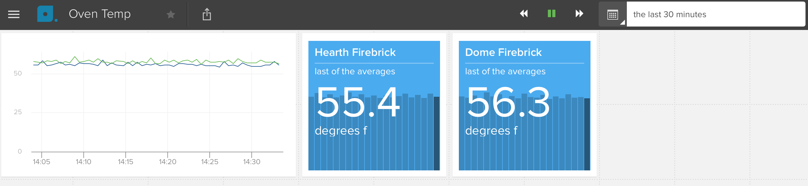

# temp-logger

Configurable temperature logger based on MAX31855 for Raspberry Pi. Sends
readings to InfluxDB (visualized with Grafana) and keeps a local daily CSV
backup.



### Configuration

Create a YAML file on your pi at `/etc/temp-logger.yml` like:
```yaml
logfile: /home/pi/temp-logger.log
frequency: 30
clock_pin: 21
data_pin: 20
thermocouples:
  - name: t1
    location: 'hearth firebrick'
    pin: 18
  - name: t2
    location: 'dome firebrick'
    pin: 17
data_dir: /home/pi/oven-data
csv_retention_days: 30          # daily CSVs older than this are deleted
calibration_file: /etc/calibration.yml
influxdb_token: YOUR_TOKEN
influxdb_org: YOUR_ORG
influxdb_bucket: YOUR_BUCKET
influxdb_url: https://YOUR_INFLUX_HOST
```

### Install / deploy

The logger runs as a systemd service. Clone the repo to `/home/pi/temp-logger`
and run the one-time setup:
```
git clone https://github.com/dlleigh/temp-logger.git
cd temp-logger
make setup          # apt deps, venv, systemd unit, logrotate
sudo systemctl restart temp-logger.service
```

`setup.sh` is idempotent -- re-run it after changing dependencies or the unit
file. On every boot the service does a best-effort `git pull --ff-only` and then
runs from the local checkout, so a missing network never stops logging; it just
runs the last-known-good code. Heavy deps (numpy/scipy) come from `apt` as
prebuilt packages, so nothing compiles on the Pi.

- Service logs (stdout/stderr): `journalctl -u temp-logger -f`
- Application log: the `logfile` path above, rotated daily by logrotate.

### Acknowledgements:

Thanks to @Tuckie for providing the [Python library for the MAX31855](https://github.com/Tuckie/max31855)
